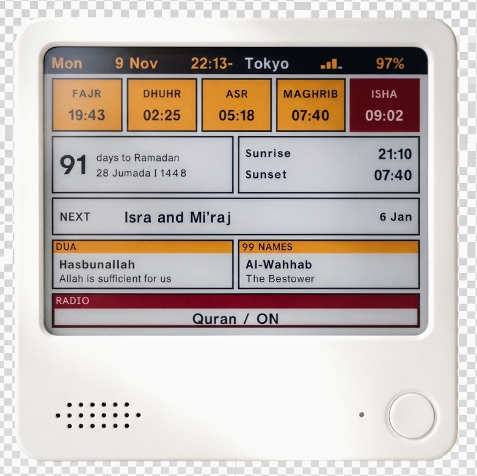

<h1 align="center">☪️ QuranTrix</h1>

<p align="center">
A dashboard for Quran radio, prayer times, Islamic holidays, Ramadan schedules, Dua of the Day, and a daily reminder featuring one of the 99 Names of Allah.
</p>

<p align="center">
  
</p>

## Requirements

- [ZECTRIX NOTE4](https://www.zectrix.com/en/note4.html) or [NOTE4C](https://www.zectrix.com/en/note4c.html)  
- USB-C cable  
- [Claude](https://claude.com/) or [Cursor](https://cursor.com) to help you flash the firmware

## Setup

Hold the round button for about two seconds. The display opens a setup window for about five minutes and shows a pairing code. Hold again while it is open to close it early.

1. Join the Wi-Fi network **QuranTrix-Setup**.
2. Open `http://192.168.4.1`.
3. Enter the code from the display.

The page stays on that code until the phone is paired. Then it opens the rest of the settings. A phone that already paired skips the code. From there you can save the home Wi-Fi network, search for a place, and change the dashboard.

**Place search** uses Open-Meteo. The desk searches for you when it is on home Wi‑Fi with internet (`GET /api/geocode`). If the desk is still on setup Wi‑Fi only, search uses your phone’s internet instead. **Offline:** pick a city from the built-in list (time zone and coordinates are filled in), or choose **Time zone** and tap **Save coordinates** with latitude and longitude.

Pairing tokens live in the device’s `home_nvs` storage, so they survive an application flash. The desk remembers up to four phones. Pairing on **QuranTrix-Setup** (`192.168.4.1`) clears older tokens and keeps only this phone. Pairing later on your home network adds another phone, up to the limit of four.

The home network name and password are stored only in the device’s `home_nvs` partition. They are not in this repository. A full flash backup can contain them.

### NOTE4 vs NOTE4C

One firmware image supports both boards. They share the same controls, Wi-Fi, audio, and layout, but the e-paper is different:

| Hardware | Panel |
| --- | --- |
| **NOTE4C** | Four pigments (black, paper, yellow, red) |
| **NOTE4** | Black and white only |

The firmware **cannot detect** which panel is installed. **Auto** assumes **NOTE4C** so existing colour devices keep working. On a monochrome **NOTE4**, open **Settings → Look → E-paper model** and choose **NOTE4 black & white**, then save. Restart the device (hold both volume keys for about 3.5 seconds) so the slower panel clock is used. The dashboard is drawn without yellow or red, then converted for the NOTE4 driver.

## Controls

| Control | Action |
| --- | --- |
| Round button, 1 tap | Radio on / off |
| Round button, hold ~2 s | Open setup (hold again to close) |
| Round button, 3 quick taps | Refresh the screen only |
| Side Up / Down, short | Volume |
| Side Up / Down, hold (~2 s) | Next / previous station |
| Side Up + Down together, hold (~3.5 s) | Restart the device |
| NFC tap | Check off the current prayer |

An NFC tap checks off the prayer that is current. A chime plays, the paper refreshes, and that prayer’s tile fills yellow. A prayer that has passed without a tap is red. The marks clear at local midnight. The paper redraws on its own at most every four hours, and not between 00:00 and 06:00 local time. Each prayer time still refreshes the paper, including Fajr. A prayer tap, the radio, setup, and a triple-tap still refresh. The adhan at those times stays off until it is turned on in settings. It does not play while the radio is already on.

## Features

- **Top bar:** weekday, date, time, place, Wi-Fi, and battery. Each one can be shown or hidden, and the row can be reordered. The clock follows the place’s time zone. When the time sits next to the place, a dash separates them. The date can be a civil format, or the Hijri date, such as 28 Jumada I 1448.
- **Prayers:** Fajr, Dhuhr, Asr, Maghrib, and Isha. The current prayer and the ones still ahead have no background until an NFC tap fills that tile yellow. The current one has a red border until then. Each earlier prayer is red, or yellow if it was tapped. Times are calculated on the device from the saved place, in that place’s time zone. The method sets Fajr and Isha: Muslim World League, ISNA, Egyptian, Umm al-Qura (Makkah), or the University of Karachi. Asr follows the Shafi or Hanafi school. Adhan at the prayer minute is a setting, off by default.
- **Ramadan:** days until Ramadan, or days left while it is Ramadan, with the Hijri date. It shares one row with sun times.
- **Sun times:** sunrise and sunset, or Suhoor and Iftar stacked during Ramadan.
- **Holiday:** the next Islamic holiday. Today is filled, and a holiday within two weeks uses the accent. The line follows a public Muslim holidays calendar (Google’s Islamic holiday agenda, or another https iCal address). Until that calendar arrives, the paper uses its built-in dates.
- **Dua of the day:** a short transliteration and its meaning, in Latin letters. It shares one row with the 99 Names. Both change with the local date (31 duas, 99 names).
- **99 Names:** one of the names each day, with its meaning, beside the dua.
- **Radio:** the line reads Quran with ON or OFF. The default station is Qurango Tarateel (`https://qurango.net/radio/tarateel`).
- **Blocks:** prayers, Ramadan, sun times, the holiday, the dua, the 99 Names, and the radio can each be turned off. The top bar stays.
- **Borders:** a frame can sit around the prayers, the Ramadan count, sun times, the holiday, the dua, the 99 Names, or the radio.
- **Language:** the page and the paper are in English. A saved language from an earlier version is read as English. The pairing page is titled Setup, and the page is titled Settings once the phone is paired. The page shows v1.0 at the bottom. The paper shows v1.0 in the pairing bar, next to the word Setup.
- **Themes:** Classic, Sunset, Ocean, Marquee, Chorus, Brass, Spotlight, or custom pigments. On **NOTE4C**, the panel has four pigments: black, paper, yellow, and red. On **NOTE4**, themes use black and paper only. Dark mode swaps paper and black.

## Build

QuranTrix builds with [ESP-IDF](https://docs.espressif.com/projects/esp-idf/en/stable/esp32s3/) 6.0 for the ESP32-S3.

```sh
. "$HOME/esp/esp-idf/export.sh"
cd firmware
idf.py set-target esp32s3
idf.py build
```

The application image is `firmware/build/QuranTrix.bin`. Flash that file at `0x20000` only. Leave the bootloader and the partition table on the device as they are.

## License

Version 1.0. MIT. See [LICENSE](LICENSE). Font notices for the type shipped in the firmware are in `licenses/`.
